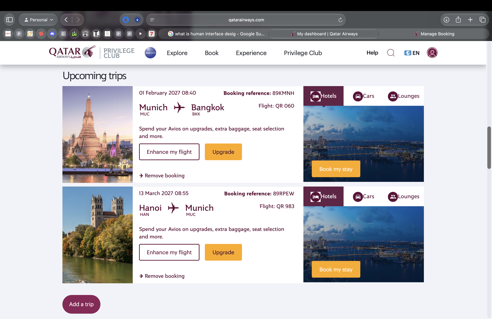
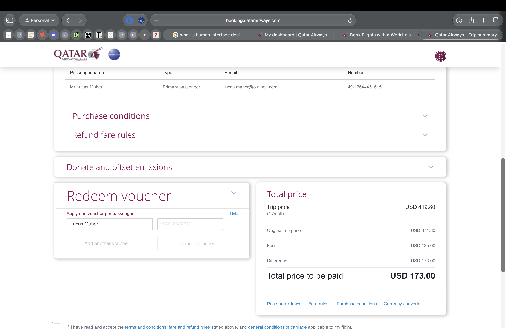
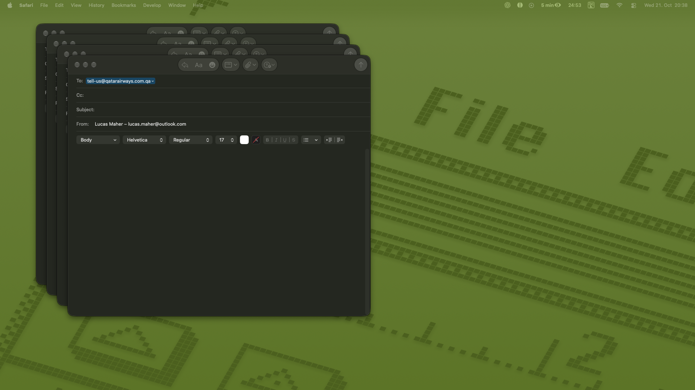

# Flight rescheduling · 21 October 2026

## Confirmed booking references

Source: Lucas’s Qatar Privilege Club dashboard screenshot, 21 October 2026, 20:38.

| Direction | Reference | Original departure | First flight shown |
|---|---|---|---|
| Munich → Bangkok, via Doha | **89KMNH** | **1 February 2027, 08:40** | **QR060** |
| Hanoi → Munich, via Doha | **89RPEW** | **13 March 2027, 08:55** | **QR983** |

The earlier assumption that both directions were under 89KMNH was incorrect. The dashboard shows two separate booking references. Request change/refund conditions and prices for each booking; do not assume one combined change fee or identical fare rules. The screenshot does not establish individual ticket prices or whether the tickets are contractually linked.

The previous planner records arrival in Bangkok on 2 February at 06:40 and arrival in Munich on 14 March at 06:55. These arrival times are not shown in this dashboard screenshot. The planner records €658 total including baggage; the split between bookings remains unverified.

## New travel window

- Earliest Munich departure: **19 January 2027**. Later departure is possible.
- Latest Munich arrival: **28 February 2027**. Earlier return is possible.
- Prefer the longest affordable trip within that window.
- Actual reason for rescheduling: APE Entrepreneur Program conflict. Lucas asked to describe the reason to Qatar as family reasons.

## Contact and status

- Lucas confirmed sending the enquiry to **tell-us@qatarairways.com.qa** on 21 October. No reply recorded.
- The original enquiry used 89KMNH. Lucas confirmed sending a follow-up on 21 October with the additional return reference **89RPEW**, without repeating the refund request. Supply both references when calling.
- Germany telephone: **+49 69 1748 9914**. Official source: https://www.qatarairways.com/en-de/legal/eu-legal-contact-information.html
- Call hours: **08:00–17:00**, supplied by Lucas; weekdays/timezone not independently established.
- Lucas plans to call **22 October 2026**. No reminder scheduled.
- No flight change, cancellation or refund confirmed. Lucas supplied approximate online change/refund amounts and a quote screenshot at 20:48; see below.

## Cost context · 21 October 2026, 20:48

- **Lucas reports:** rescheduling costs approximately **€150 per directional booking**, approximately **€300 for both**. These are his approximate figures; do not add an assumed fare difference again without checking what the quoted total includes.
- **Lucas reports:** cancellation returns approximately **€150 per booking**, approximately **€300 total refunded**, not a €150 cancellation fee.
- **Screenshot:** trip price USD 419.80; original trip price USD 371.80; fee USD 125.00; total additional payment **USD 173.00**. This equals USD 48.00 price increase plus USD 125.00 fee.
- The screenshot does not show the booking reference or selected dates. Do not assign this quote to one direction, claim both quotes were visually verified, or treat USD 173 as an exact EUR amount.
- No payment, rescheduling or cancellation confirmed. Final dates and complete per-booking totals remain to be confirmed.

Additional supplied image: [Mail windows](evidence/2026-10-21/qatar-mail-windows-2048.png).

## Next actions

1. Request change quotes for **both references**, separately itemised, for the flexible window above. Include fare difference, change/service fees and baggage.
2. Request the cash refund amount for each unused booking without authorising cancellation. Distinguish vouchers from cash.
3. Compare total extra change payments with new equivalent flight prices minus confirmed cash refunds.
4. Confirm only the selected option, then save the new e-tickets. Update Bangkok accommodation once flights are fixed.

## Other supplied screenshot

This image shows several blank Mail compose windows addressed to Qatar. It is saved as supplied; it does not prove that an email was sent. Sending is recorded above only because Lucas explicitly confirmed it.

